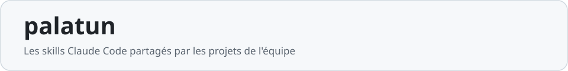
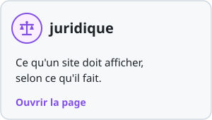
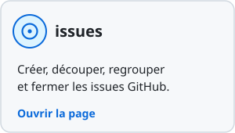
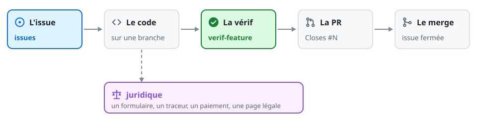

<p align="center">
<a href="docs/verif-feature.md"></a>
<a href="docs/juridique.md"></a>
<a href="docs/issues.md"></a>
</p>

## Où ils interviennent



Claude les charge seul quand ta demande s'y prête ; pour en forcer un : `/palatun:<skill>`.

## Installer

Un projet qui déclare le plugin le propose à l'ouverture de Claude Code : accepter. À la main :

```
/plugin marketplace add mklin-dev/palatun-skills
/plugin install palatun@palatun-skills
```

Mettre à jour : `/plugin marketplace update palatun-skills`, puis `/plugin update palatun@palatun-skills`.

<details>
<summary>Déclarer le plugin dans un projet</summary>

Dans son `.claude/settings.json`, commité :

```json
{
  "extraKnownMarketplaces": {
    "palatun-skills": { "source": { "source": "github", "repo": "mklin-dev/palatun-skills" } }
  },
  "enabledPlugins": { "palatun@palatun-skills": true }
}
```

</details>

## Modifier un skill

**Ne rien modifier ici** : ce dépôt est régénéré ; une correction se demande à l'auteur du plugin.
