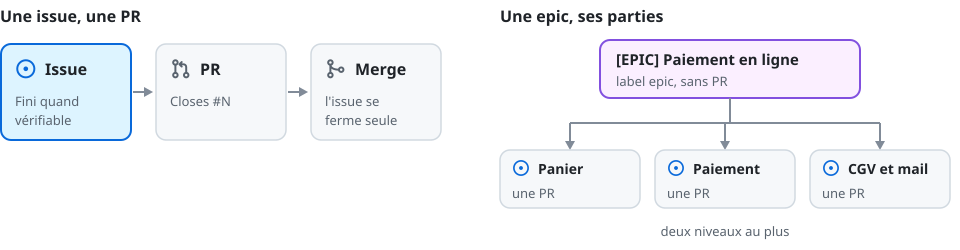

[← Accueil](../README.md)

# 🎫 issues

Une issue dit ce qu'une PR doit livrer et quand c'est fini. Moins il y en a, mieux on les suit.

> [!TIP]
> Se lance sur « crée une issue », « découpe en tickets », « fais une epic ». Pas pour Jira.

- **Une issue = une PR** : la PR porte `Closes #N`, l'issue se ferme au merge sur la branche par
  défaut. Créée sur ton accord ; un fix fait tout de suite n'en a pas besoin.
- **Son corps**, dans cet ordre : le besoin et ce qu'il faut ; **Fini quand** : ce qu'on vérifie
  (une commande, un écran, un test), pas une intention ; les fichiers pressentis, revérifiés dans
  le code au lancement (aucun pour une `task`) ; `## Todo` en dernier : les étapes, ou les unités
  quand le même geste se répète ; une issue créée d'avance le reçoit au lancement.
- **Un seul label** : `bug` (ça casse), `enhancement` (feature, amélioration), `task` (geste humain
  sans code, fermé à la main), `epic`. Pas de jalon.
- **Une epic** : jamais de `Closes #<epic>` ; son corps : l'objectif, les décisions, puis
  « Prochaine étape : … ».

## Fermer, abandonner, regrouper

| Situation | Geste |
| --- | --- |
| la PR est mergée | l'issue se ferme par `Closes` |
| la dernière sous-issue se ferme | l'epic avec elle ; née d'un audit : quand les mêmes audits, rejoués, ne trouvent plus rien |
| abandon | `gh issue close <n> --reason "not planned" --comment "<une phrase>"` |
| trop d'issues | les critères des petites passent dans celle qui les absorbe ; elles se ferment `not planned`, « Repris dans #M » |
