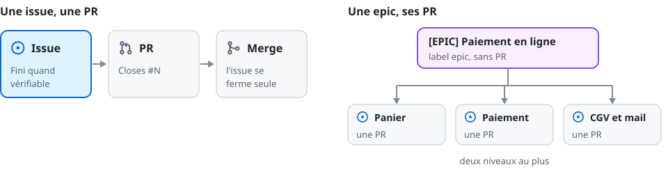

[← Accueil](../README.md)

# 🎫 issues

Une issue dit ce qu'une PR doit livrer et quand c'est fini. Moins il y en a, mieux on les suit.

Les règles exactes (le corps d'une issue, les labels, l'epic, le plan local, fermer, abandonner,
regrouper) : [le skill](../plugins/palatun/skills/issues/SKILL.md).
