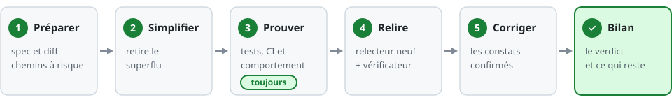
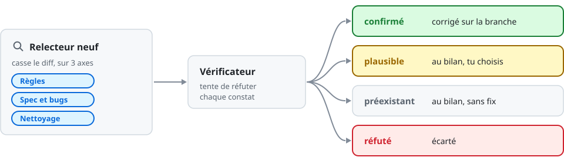

[← Accueil](../README.md)

# ✅ verif-feature

Prouver au lieu d'affirmer : Claude vérifie une branche finie et rend un bilan qui dit si elle est
prête.

> [!TIP]
> Se lance sur « vérifie la feature », « code review », « audit avant merge ». Pas pour une spec ou
> un plan avant le code, ni pour l'audit d'un projet entier.

Le détail des étapes

| Étape | Ce que fait Claude |
| --- | --- |
| 1. Préparer | lit l'`AGENTS.md` du projet et la spec (issue, ticket, plan) ; sort le diff, les commits, les chemins à risque ; met la branche à jour sur sa base |
| 2. Simplifier | retire duplication, restes de debug, ancien chemin gardé, abstraction inutile |
| 3. Prouver | les tests touchés, les commandes de la CI, le vrai comportement (navigateur, CLI, SQL) ; un bug : son test rouge, puis vert |
| 4. Relire | dans la session, ou par un relecteur neuf puis un vérificateur |
| 5. Corriger | les constats confirmés, sur la branche ; le reste va au bilan |
| Bilan | dans le chat, trois points : le verdict et ce qui change, ce qui te reste, puis « À faire avant de merger : … » ; le détail dans `bilan.md` et la section « Vérif » de la PR |

## La relecture

Elle grandit avec le risque :

| Le travail | Relecture | Contre-vérification |
| --- | --- | --- |
| retouche, ou sans logique nouvelle (déplacé, renommé, doc, config) | dans la session | non |
| feature, gros chantier, ou chemin à risque, quelle que soit la taille | relecteur neuf | oui |

Chemin à risque : auth, RLS ou SQL, secrets, migration de données ; `AGENTS.md`, `CLAUDE.md`,
`SKILL.md`, agents, settings, hooks ; workflows CI ; la ligne `À risque` du projet.

> [!NOTE]
> « Vérifie », « code review » ou « audit » seul, ou la branche d'un autre : lecture seule. Tout le
> passage, mais rien ne s'écrit ; les fixes arrivent au bilan comme propositions.

## Le régler pour ton projet

Dans l'`AGENTS.md` du projet : § Commandes (lint, types, tests, build), et dans § Flow deux lignes
optionnelles, `À risque` (des chemins sensibles en plus) et `En plus` (une étape propre, et l'étape
qui la lance).
