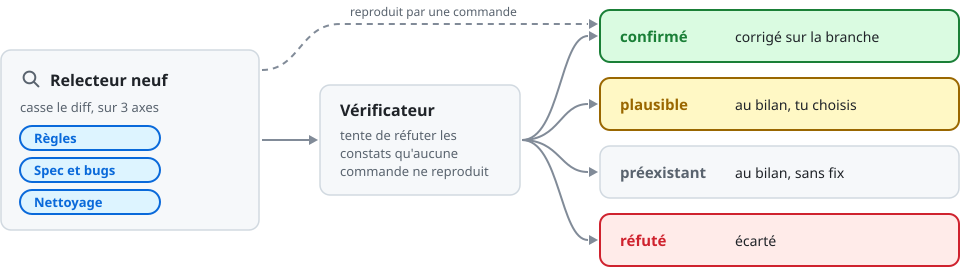

[← Accueil](../README.md)

# ✅ verif-feature

Prouver au lieu d'affirmer : Claude vérifie une branche finie et rend un bilan qui dit si elle est
prête.

Les règles exactes (chaque étape, les chemins à risque, la lecture seule, la forme du bilan, ce
qu'un projet règle dans son `AGENTS.md`) : [le skill](../plugins/palatun/skills/verif-feature/SKILL.md).
