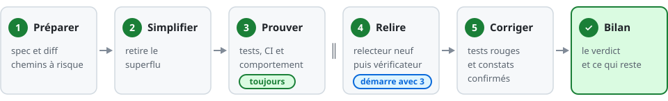

[← Accueil](../README.md)

# ✅ verif-feature

Prouver au lieu d'affirmer : Claude vérifie une branche finie et rend un bilan qui dit si elle est
prête.

> [!TIP]
> Se lance sur « vérifie la feature », « code review », « audit avant merge ». Pas pour une spec ou
> un plan avant le code, ni pour l'audit d'un projet entier.

La relecture grandit avec le risque : dans la session pour une retouche, par un relecteur neuf puis
un vérificateur pour une feature ou un chemin à risque.

Les règles exactes (chaque étape, les chemins à risque, la lecture seule, la forme du bilan) :
[le skill](../plugins/palatun/skills/verif-feature/SKILL.md).

## Le régler pour ton projet

Dans l'`AGENTS.md` du projet : § Commandes (lint, types, tests, build), et dans § Flow deux lignes
optionnelles, `À risque` (des chemins sensibles en plus) et `En plus` (une étape propre, et l'étape
qui la lance).
